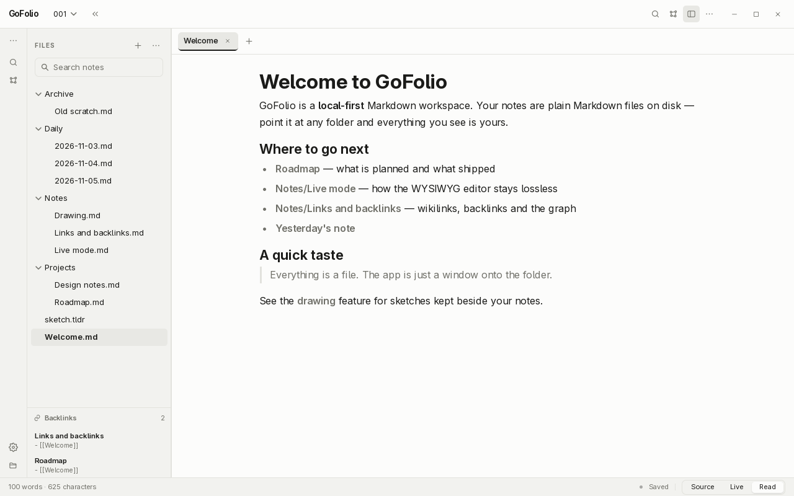
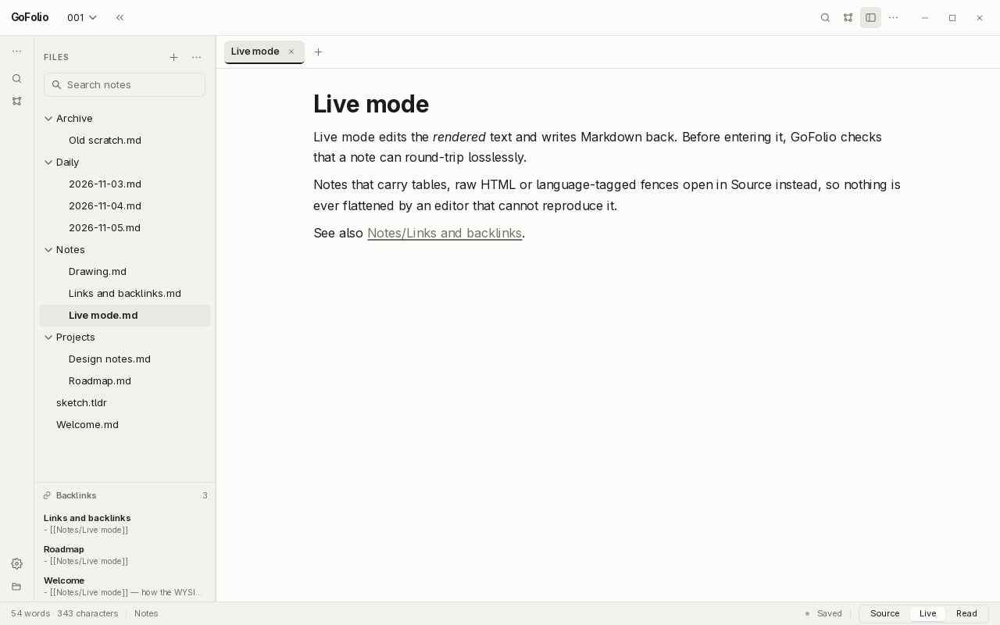
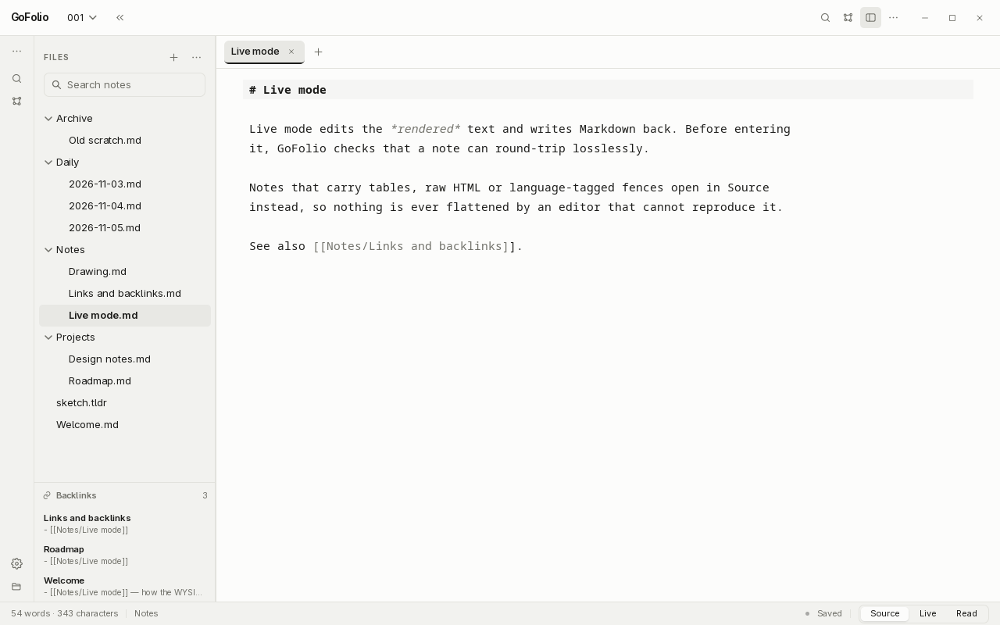
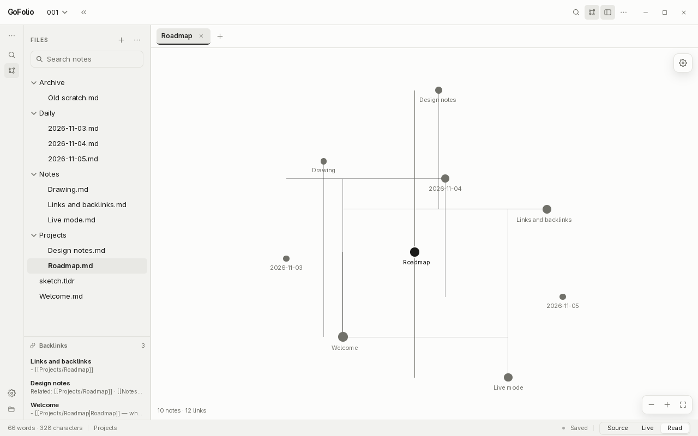
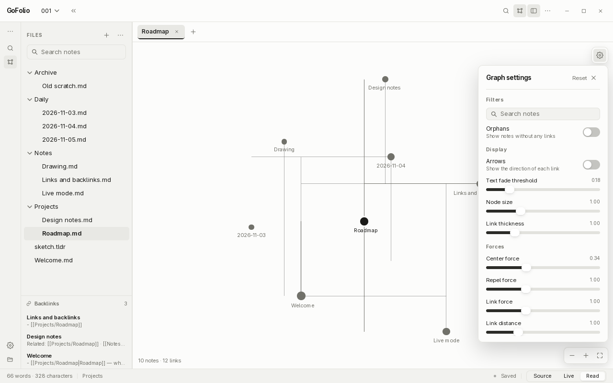
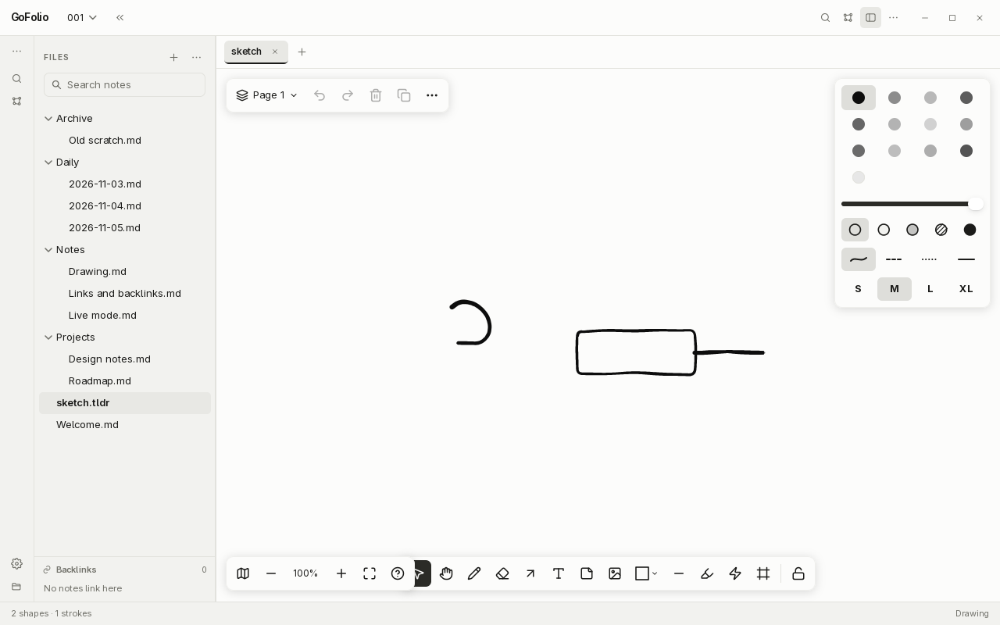
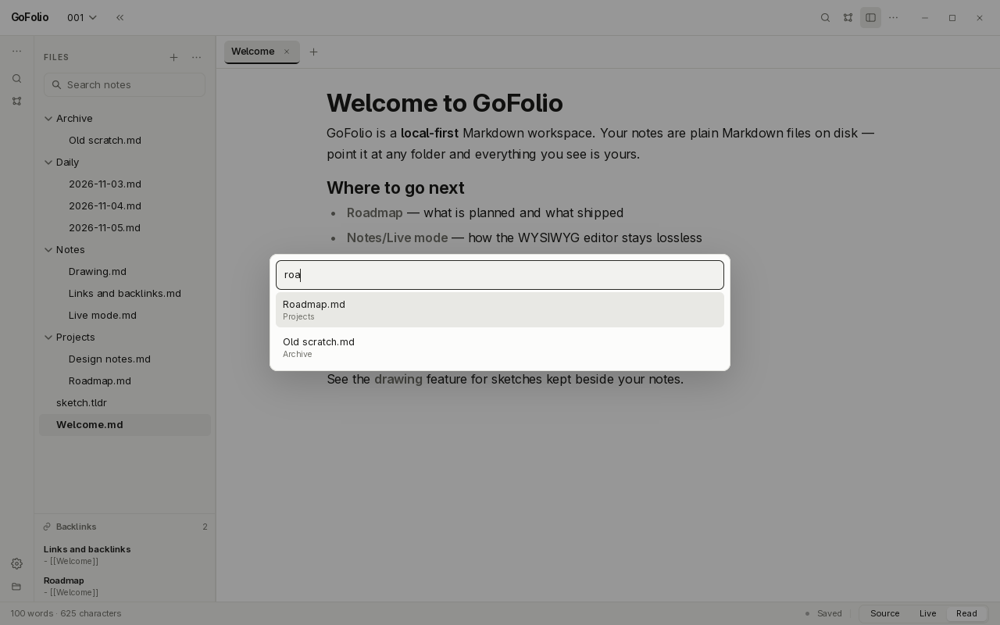
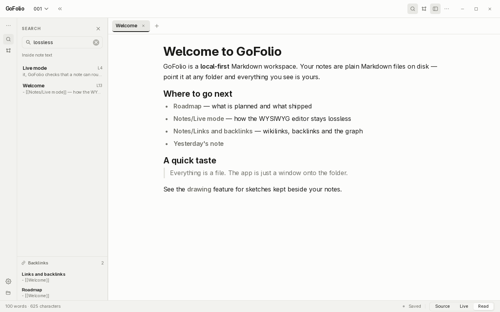
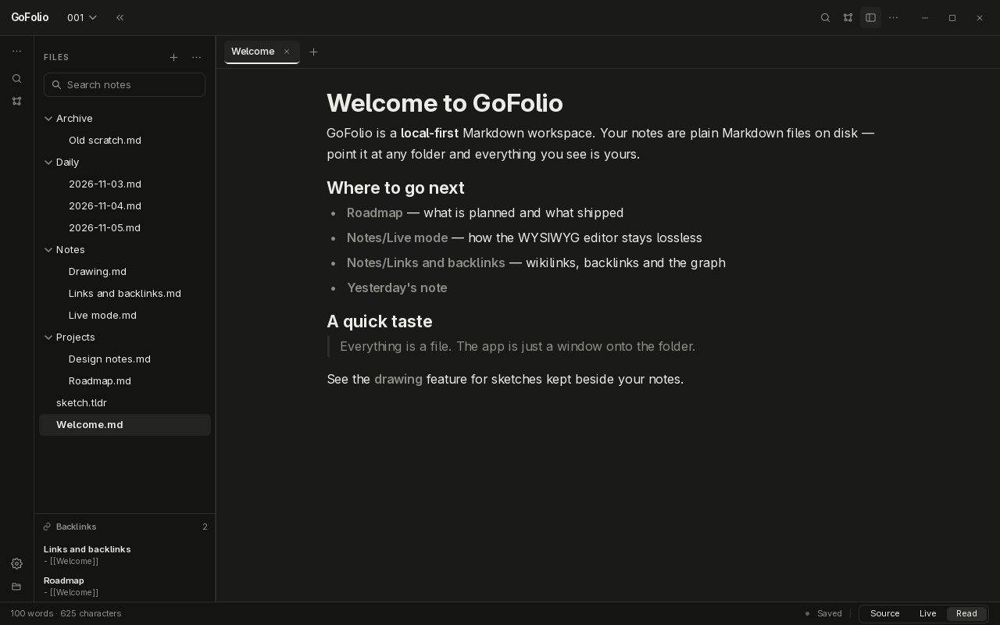

<div align="center">


# GoFolio

**A local-first Markdown workspace for the desktop. Your notes stay plain files on disk.**

Three editor modes over any folder of `.md` files, a WYSIWYG that refuses to lose
your data, wikilinks and backlinks, a hand-drawn sketching surface, and a link graph
that reads like Obsidian's — all drawn with [MyGo](https://github.com/egoist/mygo)'s
native `ui`, no webview in sight.

[](https://go.dev)
[](https://github.com/egoist/mygo)
[](./LICENSE)
[](#requirements)
[](#testing)

[Why GoFolio](#why-gofolio) · [Screenshots](#screenshots) · [Features](#features) · [Shortcuts](#keyboard-shortcuts) · [Install](#install) · [Build](#build-and-run) · [Design](#design-principles)

</div>

---

## Why GoFolio

Most note apps own your words. They store notes in a database, invent a plugin
format, and ask you to trust their sync. GoFolio does the opposite: a vault is a
folder, a note is a file, and the app is a window onto that folder.

- **Plain files, always.** Point it at an Obsidian vault, a Git repo or a folder of
  text. Everything you see on screen is on disk, unchanged, in Markdown.
- **A WYSIWYG that cannot lose data.** Before entering Live mode, GoFolio proves the
  note can round-trip losslessly. Tables, raw HTML and language-tagged fences open in
  Source instead — with a reason, never a silent rewrite.
- **Native, not a web page.** Every pixel is drawn by MyGo's `ui`, `editor` and
  `markdown` packages. The window is a real surface: no Electron, no browser engine.
- **One monochrome palette.** Black, grey and white in both appearances. The
  drawing surface is remapped to the same grey ramp, so a sketch sits in the
  text rather than shouting over it.
- **Fast and quiet.** Tabs, atomic saves, per-vault state, no telemetry, no network.

## Screenshots

**Read, Live and Source** — one note, three ways:

| Read | Live |
| --- | --- |
| [](./docs/screenshots/read-mode.png) | [](./docs/screenshots/live-mode.png) |

**Source** shows the Markdown exactly as it sits on disk — the mode that always works:

[](./docs/screenshots/source-mode.png)

**Link graph** — the vault's notes and links, in Obsidian's shape, with the same
Filters / Display / Forces settings behind the cog:

| Graph | Settings |
| --- | --- |
| [](./docs/screenshots/graph.png) | [](./docs/screenshots/graph-settings.png) |

**Drawing surface** — sketches kept beside your notes as `.tldr`, with a full tool rail,
grey-only palette and inline embeds in Read mode:

[](./docs/screenshots/drawing.png)

**Quick switcher and full-text search** over the whole vault:

| Quick switcher | Search inside notes |
| --- | --- |
| [](./docs/screenshots/quick-switcher.png) | [](./docs/screenshots/search.png) |

**Dark appearance** — the same warm neutrals, inverted:

[](./docs/screenshots/dark.png)

## Features

### Editor

- **Three modes per note.** Source, Live and Read, switched from the status bar or
  with `⌘1` / `⌘2` / `⌘3`. Each tab remembers its own mode.
- **Live mode is lossless or it refuses.** `liveUnsafe` inspects a note before Live is
  entered. Tables, `---`, language-tagged fences, raw HTML, `$$` math and `.tldr`
  embeds that would not survive the round trip are named in the status bar and the
  note opens in Source instead. Nothing is ever rewritten through an editor that
  would flatten it. The one exception: a `.tldr` embed survives as a plain image link.
- **Word and character count**, dirty state and file path in the status bar.

### Vault and files

- **Tabs** with a close button on the active tab, `⌘W`, and a `+` for a new tab.
- **Sidebar tree** with folders, drag-to-move, multi-select (`⌘A`, `⇧`-click ranges),
  double-click or `F2` to rename, and a `…` menu for sort, collapse and reveal.
- **Context menus** on every row: new note, drawing or folder; rename, duplicate,
  copy path, reveal, move to Trash.
- **Deleting goes to `.trash`.** Nothing is ever unlinked. Saves are temp-file +
  rename, so a crash mid-write leaves the old note intact.
- **Per-vault state.** Window layout, open tabs, modes, sidebar and graph settings
  come back on the next launch, from `~/.config/GoFolio/state.json`.

### Links and search

- **Wikilinks.** `[[Note]]`, `[[Note|alias]]` and `[[folder/Note#Heading|alias]]` open
  in tabs; Read renders them as links and Live writes them back as wikilinks.
- **Backlinks** under the tree, each with a line of context.
- **Full-text search** (`⇧⌘F`) inside every note; a result jumps to Source, selects
  the match and scrolls to its line.
- **Quick switcher** (`⌘P`) by fuzzy name; type `>` for commands.

### Graph

- Notes are nodes, links are edges, and the busier a note the larger its dot.
- **Force layout** in the spirit of d3-force: collision-based separation, damped link
  springs and mild gravity settle the graph into Obsidian's round cloud rather than
  a lattice of rows. The largest connected component is framed; orphans ring outside it.
- **Hover** lights a note and its neighbours and fades the rest. **Click** opens the
  note. **Drag** pans; `⇧`-drag moves a single node.
- **Settings** behind the cog: Filters (search, orphans), Display (arrows, text fade,
  node size, link thickness) and Forces (center, repel, link force, link distance),
  with Reset. Everything is remembered.

### Drawings

- A drawing is one `.tldr` file beside your notes, opened as its own tab.
- **Full godraw-style surface**: select, draw, arrow, line, rectangle and more, with a
  frame/shape/align panel, and a strictly grey palette.
- **Inline embeds.** `![[sketch.tldr]]` in Read mode shows the drawing in the page.
- Exports to the shape/size you need straight from the tool rail.

## Keyboard shortcuts

| Action | Shortcut |
| --- | --- |
| New note | `⌘N` |
| New folder | `⇧⌘N` |
| New drawing | `⇧⌘D` |
| Open vault… | `⌘O` |
| Save | `⌘S` |
| Quick switcher | `⌘P` |
| Search inside notes | `⇧⌘F` |
| Graph view | `⌘G` |
| Reload vault | `⌘R` |
| Source / Live / Read | `⌘1` / `⌘2` / `⌘3` |
| Cycle editor mode | `⌘E` |
| Close tab | `⌘W` |
| Toggle sidebar | `⌘\` |
| Rename note | `F2` |
| Move to Trash… | `⌘⌫` |
| Settings… | `⌘,` |

> On Linux and Windows, `⌘` is `Ctrl`.

## Install

Prebuilt apps are on the [releases page](https://github.com/agnogad/GoFolio/releases):

| Platform | Download |
| --- | --- |
| **Linux** | `gofolio-<version>-linux-<arch>.tar.gz` (unpacks with `install.sh`), or the `.deb` |
| **macOS** | `gofolio-<version>.dmg` (universal: Apple silicon and Intel) |
| **Windows** | `gofolio-setup-<version>-<arch>.exe` |

Verify a download against the release's `SHA256SUMS`.

### Linux, with the install script

```bash
tar xzf gofolio-0.1.0-linux-amd64.tar.gz
./install.sh          # installs under ~/.local and adds a menu entry
```

## Build and run

### Requirements

- **Go 1.27+**
- A desktop environment. GoFolio is built and tested on Linux/Wayland first, then
  macOS and Windows.

### From source

```bash
git clone https://github.com/agnogad/GoFolio.git
cd GoFolio
go run .
```

Set a vault with **Open a folder…** (`⌘O`), or let it reopen the last one. State and
recents live in `~/.config/GoFolio/`; the vault itself holds only Markdown, drawings
and a `.trash` folder.

### A packaged app

```bash
go tool mygo build                 # for this machine
go tool mygo build -platform linux/amd64,windows/amd64,darwin/universal
```

The version comes from `version` in `mygo.json`; the release workflow sets it from
the tag, so a `v0.2.0` tag publishes a `0.2.0` build.


## Testing

```bash
go test ./...
```

The suite covers vault scanning and safe paths, create/rename/trash, frontmatter and
CRLF handling, wikilink parsing and resolution, search offsets and backlinks, the
Live-mode safety check, the graph layout (roundness, no overlaps, component framing)
and its settings round trip, drawing save/load and the grey-only palette, plus headless
view smoke tests through MyGo's `ui.NewTester`.

```bash
go vet ./...            # static checks
gofmt -l .              # formatting
```

## Repository layout

```
GoFolio/
├─ main.go               the app: state, tabs, vault, commands, shortcuts
├─ ui.go                 every view: sidebar, workspace, titlebar, modals
├─ graph.go              the link graph: layout, camera, painting, settings
├─ vault.go              scanning, resolution, create/rename/move/trash
├─ session.go            what is remembered between launches
├─ theme.go              the monochrome palette for both appearances
├─ drawing*.go           the drawing surface, ported from godraw
├─ icons.go              the SVG icon set
├─ internal/
│  ├─ doc/               .tldr document model (tldraw-compatible)
│  ├─ editor/            the drawing editor: tools, shapes, actions
│  ├─ geo/               vectors, matrices, path geometry
│  └─ assets/            fonts and drawing icons
└─ docs/
   └─ screenshots/       the images in this README
```

`main.go`, `ui.go` and `graph.go` hold the app; `internal/` holds the drawing engine,
which is self-contained and could be lifted out whole.

## Design principles

- **Files are the source of truth.** The app never holds state the disk does not,
  and never rewrites a note it cannot reproduce byte-for-byte.
- **Monochrome, deliberately.** The palette is warm neutrals in light and dark,
  and the drawing surface is remapped to the same ramp. No hue, no gradients.
- **Lazy before clever.** Standard library and native MyGo elements first; a new
  dependency has to earn its place. The shortest diff that solves the real problem
  wins — after the problem is understood.
- **Refuse rather than corrupt.** When a feature cannot do the right thing, it says
  so and falls back, instead of quietly doing the wrong thing well.

## Roadmap

| Phase | Scope | Status |
| --- | --- | --- |
| P0 | Vault, tabs, three editor modes, atomic saves | ✅ Done |
| P1 | Wikilinks, backlinks, full-text search, quick switcher | ✅ Done |
| P2 | Drawing surface, `.tldr` files, inline embeds | ✅ Done |
| P3 | Link graph, Obsidian-style settings and forces | ✅ Done |
| P4 | Dark appearance, per-vault state, multi-select | ✅ Done |
| P5 | Accessibility pass, packaging for all three platforms | 🚧 In progress |

## Contributing

Issues and pull requests are welcome. Before opening a PR:

1. Keep the palette monochrome. A new colour is a design change, not a detail.
2. Never let a save path rewrite a note it cannot read back losslessly.
3. Run `gofmt -l .`, `go vet ./...` and `go test ./...`.
4. If you change a view, add or update a headless test through `ui.NewTester`.

Open an issue before large features so the shape can be agreed first.

## License

Released under the [MIT License](./LICENSE). Copyright © 2026 GoFolio contributors.

<div align="center">

Built with [MyGo](https://github.com/egoist/mygo) · Drawing engine ported from [godraw](https://github.com/agnogad)

</div>
